# Condense user guide

From recordings to a checked transcript in MAXQDA. Every picture shows invented demo data: a test pattern instead of
a video, made-up dialogue and the stand-in names Robin, Sam and Kim.

Shortcuts are written **Mac / Linux and Windows**, for example **⌘↩ / Ctrl+Enter**. *View ▸ Keyboard Shortcuts*
(⌘/ or Ctrl+/) lists them all for your system.

**Contents:**
1. [Install and update](#1-install-and-update)
2. [From recording to transcript](#2-from-recording-to-transcript)
3. [Trim before transcribing](#3-trim-before-transcribing)
4. [Reviewing a transcript](#4-reviewing-a-transcript)
5. [Speakers](#5-speakers)
6. [Notes, find and replace, filters](#6-notes-find-and-replace-filters)
7. [Cutting parts out](#7-cutting-parts-out)
8. [Episodes: interviews and activity phases](#8-episodes-interviews-and-activity-phases)
9. [Coding](#9-coding)
10. [Projects: many sessions of one study](#10-projects-many-sessions-of-one-study)
11. [Into MAXQDA](#11-into-maxqda)
12. [Your data](#12-your-data)
13. [When something goes wrong](#13-when-something-goes-wrong)

---

## 1. Install and update

The install guides cover one-line installation for [macOS](install-mac.md), [Linux](install-linux.md) and
[Windows](install-windows.md).

- **Updates:** Condense checks once a day and offers new versions. To check by hand, use *Help ▸ Check for Updates…*
  (on the Mac, *Condense ▸ Check for Updates…*). It updates itself and restarts. You can turn the daily check off in
  the same menu.
- **Is the GPU working?** *Help ▸ Test GPU…* runs a short calculation on the graphics card and tells you whether
  Whisper will use it. Run it once after installing. Without a GPU, a one-hour recording can take hours instead of minutes.
  Condense also warns you before a run if the GPU is not usable.

## 2. From recording to transcript


1. **Add videos** (⌘O / Ctrl+O, or *+ Videos*): each video becomes one task. A session that was recorded as several
   clips (a camera that splits files) becomes one task with *+ Merge Task*: the clips are joined and you get a single
   transcript.
2. **Check the settings** (right). New tasks copy them, and each task keeps its own copy. *Task Details* (below the
   queue) shows a task's settings; *Use current Settings* updates a pending task. The settings that matter most:
   - **Steps:** *Compress* makes a smaller video for archiving and for MAXQDA. *Extract audio* keeps a separate audio
     file. *Transcribe* runs Whisper.
   - **Model:** `large-v3-turbo` is a good default. `large-v3` is slower and sometimes better with quiet or unclear
     speech.
   - **Language:** set it for single-language sessions. *Auto* only listens to the first 30 seconds.
   - **Vocabulary:** names, places and activity words Whisper should expect (`Robin, Sam, Riverside Club, papier-mâché`).
   - **Clean up for Whisper:** *Level quiet voices* helps with soft-spoken children. *Reduce noise + level voices* also
     helps in noisy rooms. Only what Whisper hears is cleaned; your video and audio stay as they are.
   - **Diarization / Speakers:** detects who speaks when. You get `SPEAKER_00`, `SPEAKER_01`, … and give them names
     afterwards (see [Speakers](#5-speakers)). If you know the number of speakers, enter it.
   - **Exports:** keep *Paragraphs RTF* on for MAXQDA.
3. **Run** (⌘R / Ctrl+R, or *Run Pending Tasks*). The *Console* tab shows each step. You can keep working on other
   transcripts while it runs.

Results go into a subfolder next to the video (`Interviews/P01.mp4` → `Interviews/P01/`), or into the output folder
you chose:

| File | What it is |
|---|---|
| `P01.transcript.json` | The master file: every word with its timing and confidence, speakers, notes, cuts, the settings, tool versions, checksums and a log of every edit. Everything else is generated from it. |
| `P01_paragraphs.rtf` / `.txt` | One paragraph per speaker turn, with a timestamp at the end of each. **For MAXQDA** and Word. |
| `P01.srt` / `.vtt` | Subtitles. |
| `P01.txt` | Plain text by segment. |
| `P01_confidence.rtf` | The transcript with words coloured by how sure Whisper was. Useful for spotting problems. |

The exports are rewritten every time you save a change in the editor.

## 3. Trim before transcribing

Setup time, breaks and the minutes after the session usually don't belong in the transcript. Select the task, then
use *Task Details ▸ Trim…*:

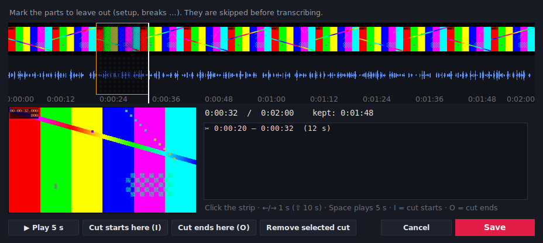

Click the frame strip to move through the video (← / → step 1 s, ⇧ 10 s; Space plays 5 s). Mark a part to leave out
with *Cut starts here* (**I**) and *Cut ends here* (**O**). *Save* writes a LosslessCut project (`.llc`) next to the
video. You can also make one in
[LosslessCut](https://github.com/mifi/lossless-cut) itself. With *Apply LosslessCut (.llc) trims* on in Settings, the
marked parts are skipped before transcribing, and the shortened video is kept next to the transcript so that its
timestamps match.

You can also cut parts out after transcribing (see [Cutting parts out](#7-cutting-parts-out)).

## 4. Reviewing a transcript

Open a finished task (click it in the queue) or *File ▸ Open Transcript…* (⇧⌘O / Ctrl+Shift+O). The *Transcript*
tab opens:

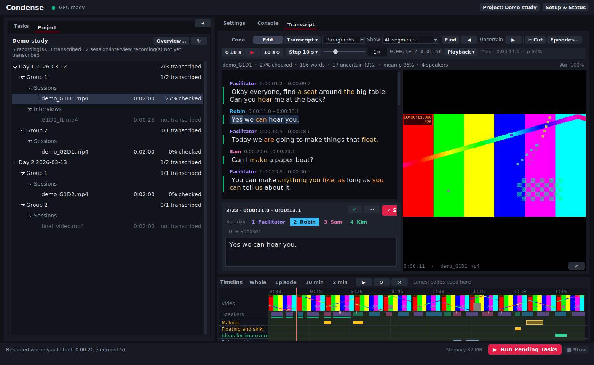

- **Top:** a timeline of the session (one colour per speaker; the ticks above it mark uncertain words), the player and the video.
- **Middle:** the transcript. Click a word to jump there; double-click to play from it. Words Whisper was unsure
  about are coloured: yellow, then orange, then red and underlined for the least certain.
- **Bottom:** the segment editor. It shows exactly the highlighted segment. Correct the text while listening.
  Unchanged words keep their exact timing. Every change is saved, logged and can be undone (⌘Z / Ctrl+Z).

**The controls, from top to bottom:** *Transcript ▾* (open, speakers, episodes, exports, mark all checked), the view
(*Paragraphs*/*Segments*), the *Show* filter, *Find…*, ◀ *Uncertain* ▶, *✂ Cut* and *Episodes…*; then the player with
*Playback ▾* for its options (follow the text, play a snippet when jumping, skip cuts, show the video, open in a video
player); in the segment editor *Mark checked*, *Split*, *Merge*, *+ Insert*, *Delete*, *More ▾* (re-transcribe, revert,
markers), *Save* and *Save & next*.

**No video next to the transcript?** That happens when the recording was trimmed (LosslessCut) and transcribed without
*Compress* in an older version, when the video was moved or renamed, or when the picture comes from a separate camera.
Choose *Link a video…* in the empty video panel (or *Playback ▾ ▸ Link a video…*) and pick the video. Condense finds
where the transcript's sound is in it and shows the matching picture: for a LosslessCut-trimmed transcript, the parts of
the original recording that were kept; for a camera that started earlier or later, the same moment. Nothing is
re-encoded and the video file is not changed; the link is saved in the transcript (undo works, *Unlink the video* removes
it). Where the linked video has no picture for a moment, the panel says so. *Export trimmed video & transcript…* only
uses a linked video if it is on the transcript's own timeline; otherwise it cuts the transcript's audio.

**A fast review loop:** click into the transcript, then

| Key | |
|---|---|
| **Space** / **Esc** | play / pause |
| **R** | replay the segment |
| **↑ / ↓** | previous / next segment |
| **← / →** | previous / next uncertain word |
| **Return** | edit the segment's text; **Esc** (or Tab) saves and takes you back to the transcript |
| **⌘↩ / Ctrl+Enter** | save, mark checked, go to the next segment (also while typing) |
| **C** | mark checked / not checked |
| **S** / **M** / **I** | split before the selected word / merge with the next segment / insert a segment |
| **Delete** (⌫ on the Mac) | delete the open segment (asks first) |
| **1 – 9** | assign speaker 1–9 |
| ⌘[ ⌘] / Ctrl+[ Ctrl+] | back / forward 5 seconds |
| ⌘⇧. ⌘⇧, / Ctrl+Shift+. Ctrl+Shift+, | faster / slower |

**Text size:** the **Aa** slider to the right, above the transcript, makes the transcript and the segment box larger or smaller (80–250 %; double-click it for 100 %), as do Ctrl/⌘ + scroll wheel over the transcript and *View ▸ Larger / Smaller Transcript Text*. It is remembered. *View ▸ Larger / Smaller Text* (⌘+ / Ctrl++) sizes the whole window.

The line above the transcript shows how much is **checked**. Checked segments get a ✓, and the queue shows the
percentage for each task. Condense remembers where you stopped in each transcript. If you reviewed a transcript elsewhere, right-click it in the Project tab or the task list and choose *Mark All Checked (100 %)* (or use the Edit menu); ⌘Z / Ctrl+Z undoes it.

**Markers** for things Whisper can't write: *More ▾ ▸ Insert marker* in the editor, or while typing ⌃L ⌃I ⌃U ⌃C ⌃P ⌃G ⌃N on the Mac
and Ctrl+Shift+L, I, U, C, P, G, N on Linux and Windows. They insert `[laughs]`, `[inaudible 0:12:31]`, `[unclear: ]`,
`[crosstalk]`, `[pause]`, `[German]` and `[gestures]`.

**When Whisper got a passage badly wrong** (mumbling, a switch of language): select it and use *Edit ▸ Re-transcribe
Passage…* (⌘⇧R / Ctrl+Shift+R) with a bigger model or a forced language. *Split (S)*, *Merge (M)*, *+ Insert (I)* and *Delete* in the editor fix
the segmentation; *More ▾* reverts your changes.


## 5. Speakers

The chips under the editor are the speakers. Their numbers are the keys:

- **One segment:** click it and press its speaker's number. While typing in the editor, use ⌃1–9 on the Mac and
  Alt+1–9 on Linux and Windows.
- **A whole stretch:** drag across the transcript, ⇧-click / Shift+click, or ⇧↓ / Shift+↓. Then press the number.
  It is one change, and one undo.

  

- **Who is who?** Speaker detection labels voices `SPEAKER_00`, `SPEAKER_01` … While such labels are left, a yellow
  **Who is who?…** chip appears next to the speakers. It lists each label with how much it speaks, a typical line and
  ▶ *Listen*; choose the name (one of your saved speakers, or type one) and all of its segments get it. Two labels can
  get the same name, when detection split one person in two. Quicker for a single label: **right-click its chip ▸ All
  segments of SPEAKER_01 are… Robin**. One undo step either way.
- **0** adds a new speaker and assigns it.
- **Transcript ▾ ▸ Speakers…** renames speakers everywhere in the transcript and its exports, for example
  `SPEAKER_01` → `Robin`. It also adds and removes speakers. Swapping two names works.

  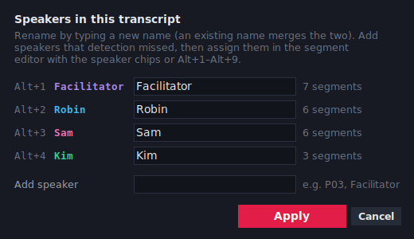

- **Transcript ▾ ▸ Detect speakers…** runs speaker detection again (for example with a different number of speakers). It keeps the
  speakers you assigned by hand.

Use pseudonyms here, not children's real names: the names end up in every export.

## 6. Notes, find and replace, filters


- **✎ Note** (under the segment text): a remark on a segment, such as context or something seen on video. Notes
  appear in the transcript and as `[Note: …]` in the TXT and paragraph exports.
- **Find & replace** (⌘F / Ctrl+F, or *Find…*): highlights every match. Return / ⇧Return step through them.
  *Replace* and *Replace all* are each one undo step, with options for case and whole words. Word timings stay.

  

- **Search all transcripts** (*Edit ▸ Search All Transcripts…*, or *All transcripts…* in the find bar): searches every
  transcript in a folder and its subfolders, and can replace everywhere. For example, it can correct a name Whisper
  always gets wrong, or swap a real name for a pseudonym. Each changed transcript gets a backup and new exports.
- **Show** filter (transcript toolbar): *Uncertain*, *Not checked*, *With notes* or *Cut*. ↑/↓ then move only through
  those segments.

## 7. Cutting parts out

Not everything recorded belongs in the analysis: setting up, a toilet break, a conversation with a parent. To cut a
segment, select it (or a stretch) and press **X**. It is struck through and left out of every export. X again restores
it, and *Edit ▸ Restore All Cuts…* restores everything. Nothing is deleted: cut segments stay in the master file. With
*Playback ▾ ▸ Skip cut parts* on, the player jumps over them.

The exports keep the **original timeline**: their timestamps match the original video. To get a **shortened video**
with a transcript timed to it, use *Transcript ▾ ▸ Export trimmed video & transcript…* (or the File menu):

- **Exact:** cuts exactly where you cut. Re-encodes the video, which takes a while for long sessions.
- **Lossless:** fast and without quality loss, but each kept part starts at the nearest keyframe before it. Condense
  measures what was really written and times the transcript to that. Cuts too short to apply losslessly are listed.
- **LosslessCut project:** writes a `.llc` so you can fine-tune and export in LosslessCut yourself.

Use the trimmed video and the trimmed transcript **together** in MAXQDA (see below).

## 8. Episodes: interviews and activity phases

An **episode** labels a stretch of a recording without removing anything. Examples are the facilitator's interview with
a group in the middle of its session, or an activity phase such as *Dioramas* or *Risks intro*. Episodes show as
coloured bands on the timeline and as headers in the transcript, and they start new paragraphs.

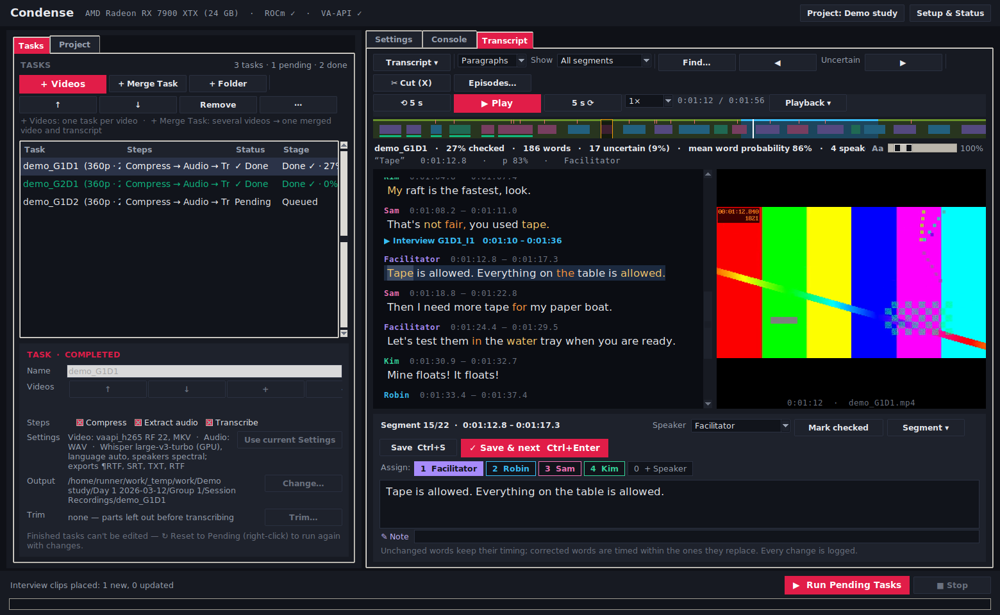

- **Mark one:** select its segments in the transcript (drag, or ⇧↓ / Shift+↓) and press **E**. Choose the type, give it
  a label (e.g. `G1D1_I1` or `Dioramas`) and check the times. Tick *approximate* for phases you only know roughly.
- **See and edit them all:** *Episodes…* in the transcript toolbar (or *Edit ▸ Episodes…*). Double-click one to go to it.

  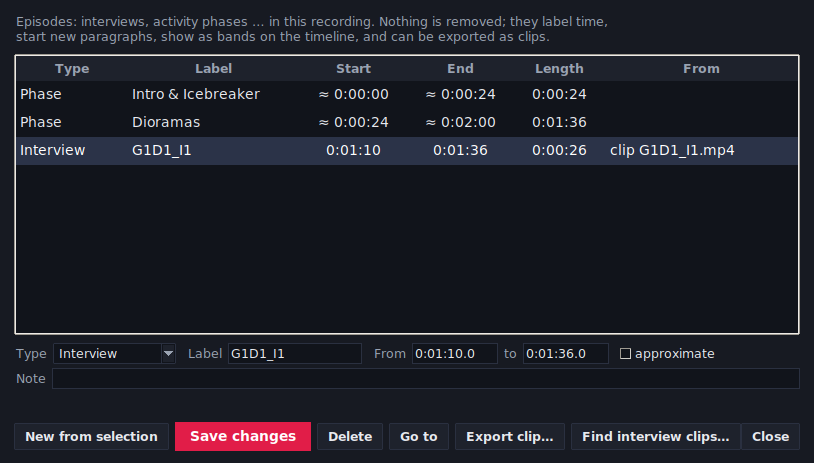

- **Work through one kind:** the *Show* filter has *In Interview*, *In Phase* … — ↑/↓ then move only through those
  segments.
- **Export one as a clip:** *Export clip…* in the Episodes dialog writes the clip and a transcript timed to it (SRT, TXT,
  paragraphs for MAXQDA), plus a small `.episode.json` record of where it came from. Interviews are saved next to the
  group's other interviews (a folder with "Interview" in its name), so you no longer need to cut them out by hand.
- **Episode types** (Interview, Phase, Plenary …) are set per project in *Project ▸ Project Settings…*.

**Interviews you already cut out:** open the group's session transcript and choose *Find interview clips…* (in the
Episodes dialog or the Edit menu). Condense lists the clips in the group's interview folder, finds each one in the
session by its **sound** (to a few hundredths of a second, whatever tool cut it), and adds them as Interview episodes
labelled with the clip's name. Matches it isn't sure about are marked so you can check them by listening. Running it
again updates the episodes instead of adding them twice.

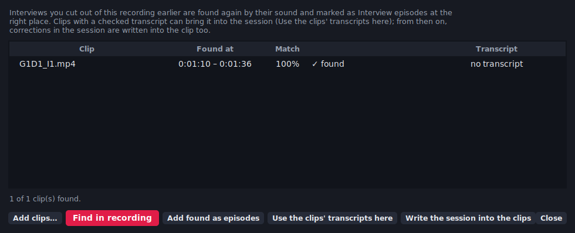

## 9. Coding

The **Coding** tab (⌘4 / Ctrl+4) codes the open transcript with the project's codebook. The codebook is kept in the
study folder (`condense-codebook.json`) and shared by all its transcripts. Coding needs a project (see [Projects](#10-projects-many-sessions-of-one-study)).

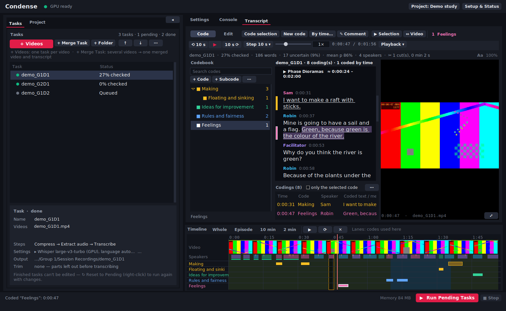

**The codebook grows while you code.**
- **New code from what you've selected:** select words in the transcript and press **N** (or *New code from selection*):
  name it, and the selection is coded with it. **+ Code** and **+ Subcode** add codes without coding.
- **Edit…** (or right-click a code) gives a code its name, place in the tree, colour, **definition**, *use when*, *not
  when*, an **example** and a **memo**. The panel below the codebook shows them for the selected code.
- **Merge into another code** (*More ▾* or right-click): all its codings get the other code, its subcodes move along,
  and its memo is added to the other's. A code that turned out too big is **split** by making a new (sub)code and giving
  the codings that belong to it the new code: select one in the list below and *Change code…*.
- **Delete** removes a code, its subcodes and their codings (asks first). Every change to the codebook is recorded in
  its log; changes to transcripts keep a backup and can be undone.

**Coding.** Select words (drag), then:
- double-click a code in the codebook, or press **Return** for the selected code;
- press **1–9** for a recent code (shown above the transcript);
- or right-click the selection.

Each coding shows as a coloured **stripe** next to the text and as a mark on the timeline. Click a stripe or coded words
to select a coding; the list below shows all codings of the transcript (or *only the selected code*) with their speaker
and text. **Memo…**, **Change code…** and **Delete coding** (or Del) work on the selected one; double-click plays it.

**Moments without speech** — working with the materials, a device, a gesture: **drag on the timeline** over the moment
(or *Moment without speech…*), choose the code and describe **what happens**. It appears in the transcript at its time
as ◆ with your description, and counts like any other coding.

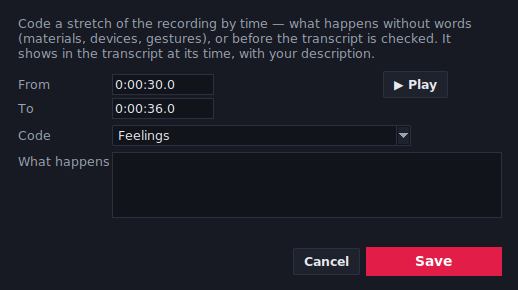

Codings stay on their words when you correct the text, split or merge segments, or re-transcribe a passage in the
Transcript tab. If every word of a coding is deleted, it is listed with ⚠ so you can decide what to do with it.

## 10. Projects: many sessions of one study

A **project** is the folder of one study. Every transcript in that folder or its subfolders belongs to it. Nothing is
moved or copied; Condense only puts a small `condense-project.json` in the folder. Projects are optional: without one,
Condense works file by file as before.

**Your folder structure stays.** When you create the project, Condense reads your structure from the folders and
writes it as a template you can check and change in *Project ▸ Project Settings…*:

```
Session folders:  {Day}/{Group}/Session Recordings
Interview clips:  {Day}/{Group}/Semi-structured Interviews/G{group}D{day}_I{n}
```

- `{Day}`, `{Group}` are the levels: any folder at that place, such as `Day 1 2026-08-10`. `{day}`, `{group}` are their
  numbers (the first number in the folder name).
- `{n}` numbers a group's interviews **across all days**: if Group 1 has I1–I13, its next interview is I14, whatever the day.
- If your clips are named in more than one way (`G1D1_I1` and `D1G4_I1`), list the patterns with `|`:
  `G{group}D{day}_I{n} | D{day}G{group}_I{n}`. All are recognised; new clips use the first. *Read from my folders* finds
  the patterns your clips already use.
- There are presets (*Workshops: Day ▸ Group*, *Interview study: Participant ▸ Session*, *One folder*) and a live
  example of where files go. *Read from my folders* suggests the template again.
- **Consent forms** and **…Unsorted** folders are skipped: never opened or listed.

Condense only *reads* your structure. It uses it to find interview clips, to name new ones (`G1D2_I14`) when you mark an
interview with **E** or export one, and to save them in the right folder.

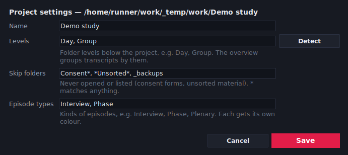

**Tidy unsorted folders** (*Project ▸ Tidy Unsorted Folders…*) shows, for each file in a …Unsorted folder, where it
belongs according to its name, and why. Files whose names don't follow the pattern, duplicates and files without a
matching folder stay where they are. **It is only a plan**: nothing is moved unless you click *Move* and confirm. Moves
are recorded in `condense-moves.json` and *Undo last move* puts the files back.

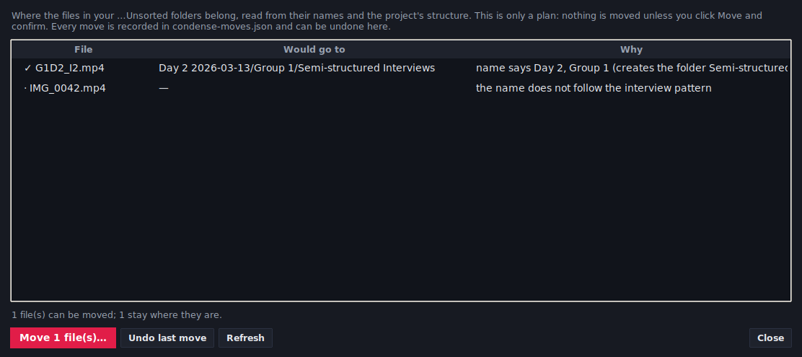


- **Start one:** *Project ▸ New Project…*, or the **No project open** button at the top right. Choose the study's
  folder: an existing one with sessions in it, or a new one you create in the folder chooser. Give the project a name
  and, if you like, its speakers.

  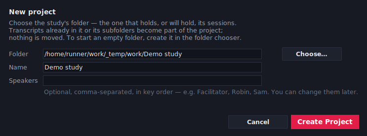

- **Open one:** *Project ▸ Open Project…* (choose the study's folder) or *Project ▸ Open Recent*. Opening any transcript
  of a study also opens its project.
- **While a project is open,** its name is shown at the top right. *Open Transcript* and *Search All Transcripts* start
  in its folder. *Project ▸ Close Project* closes it; the transcripts stay where they are.
- **Getting sessions into it:** set a task's output folder (*Task Details ▸ Output*) to a folder inside the project, or
  keep your videos in the study folder (results are saved next to them). You can also move finished session folders
  into it.

**The Project tab** (next to *Tasks*, on the left) keeps the study in view while you work: every recording by day
and group — **transcribed or not** — sorted into *Sessions*, *Interviews* and *Other recordings*, with each transcript's
progress and episodes. Double-click a transcript to open it (or an episode to go to it); double-click a recording without
a transcript to add it to Tasks. Right-click for more: transcribe several at once, find interview clips in a session,
show in folder.

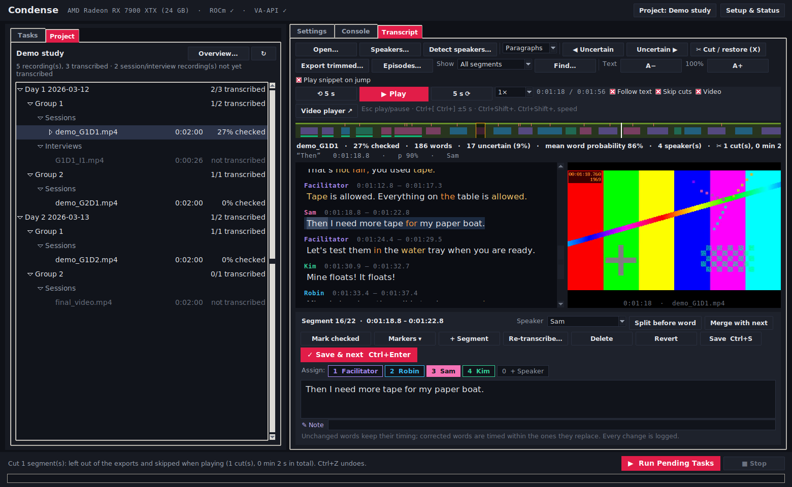

**Project overview** (click the project's name, or *Project ▸ Project Overview…*) shows the study as a tree — Day ▸
Group ▸ transcript ▸ its episodes — with totals per day and group. For each transcript it lists its length, how much is checked, the share of uncertain words, speakers (and how many still have no name), cut time,
notes and the last change. Double-click opens a transcript, or goes straight to an episode. *Save as CSV* writes `condense-overview.csv`, for your records or
your supervisor.

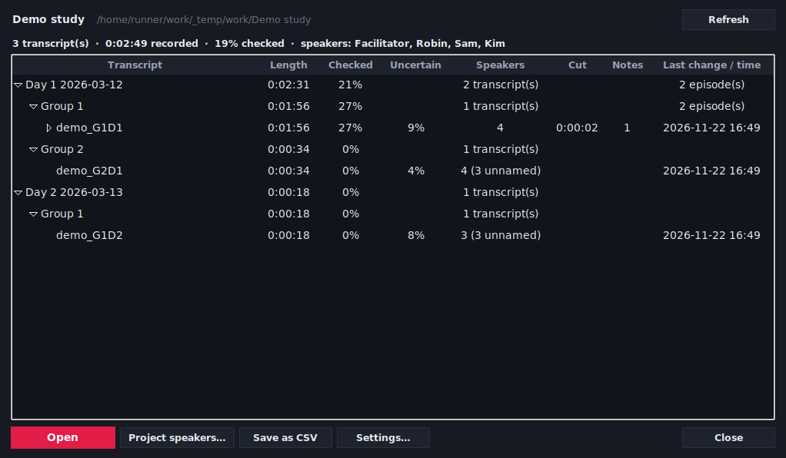

**Speakers** (*Project ▸ Speakers (Project and Groups)…*, or right-click a group in the Project tab): each group is its
own case, so there is a list for the **whole project** — people in every group, such as facilitators — and one **per
group** for its children. A transcript gets the project's speakers first, then its group's, with the same number keys
and colours in every session of that group, on every day: in Group 1, **Facilitator is always 1, Robin always 2**.
*Add names from transcripts* collects the names you have already used in that group.


## 11. Into MAXQDA

MAXQDA links a transcript to its video through the timestamps at the end of each paragraph. That is the format of
Condense's paragraph exports.

1. In MAXQDA: *Import ▸ Transcripts* (in older versions *Transcripts with Timestamps*).
2. Choose `<name>_paragraphs.rtf` (or `.txt`).
3. When MAXQDA asks for the media file, choose **the video that matches the transcript**:
   - the original video, for the normal exports;
   - the **trimmed** video, for a trimmed transcript (from *Export trimmed video & transcript…*, or from a run with `.llc` trims).

   MAXQDA only links the media file chosen during import; you can't add it later. If you pick the wrong video, the
   timestamps will point to the wrong moments.
4. Speakers appear as `Name:` at the start of each paragraph, so MAXQDA's focus-group import can code each speaker
   automatically.

MAXQDA can also import the `.srt` subtitles together with the video.

## 12. Your data

- **Everything stays on your computer.** Whisper and speaker detection run locally; nothing is uploaded. The only
  network access is the update check (to GitHub, sending no data) and, if you use it, downloading the pyannote speaker
  model with your Hugging Face token.
- The Hugging Face token is kept in the system keyring (Keychain, Secret Service or Credential Manager), never in a
  file.
- **Backups:** each transcript keeps automatic backups in a `_backups` folder next to it. To go back, use *Edit ▸
  Restore Backup…*.
- Follow your ethics approval and data-management plan for where recordings and transcripts are stored. Use
  pseudonyms in speaker names, notes and replacements.

## 13. When something goes wrong

- **Transcribing is very slow:** run *Help ▸ Test GPU…*. The [install guide](install-linux.md) for your system explains
  how to get the GPU working.
- **A task failed:** the *Console* tab shows the reason. Right-click the task and choose *Reset to Pending*, then run
  it again.
- **Whisper invents text in silence** (repeated phrases, "Thank you for watching"): trim the silent parts before
  transcribing, or cut those segments.
- **Speakers are mixed up:** enter the right number of speakers and use *Transcript ▾ ▸ Detect speakers…*, or fix stretches with
  multi-select and the number keys.
- **Report a problem:** [GitHub issues](https://github.com/s-hurtado26/condense/issues). Never attach recordings or
  transcripts of participants. Describe the problem, or reproduce it with a test video.
