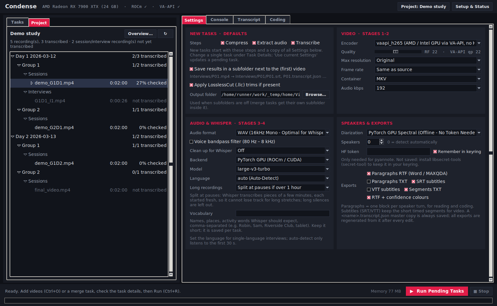
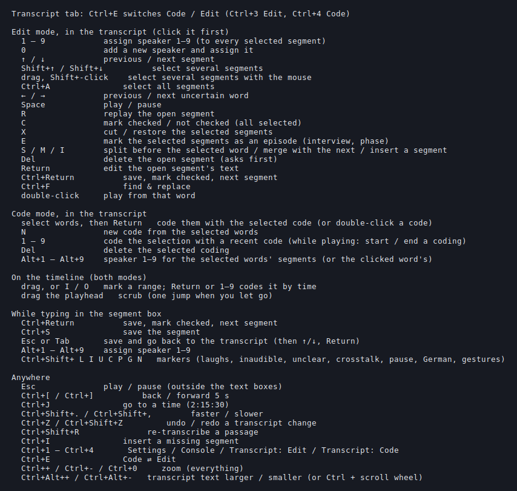
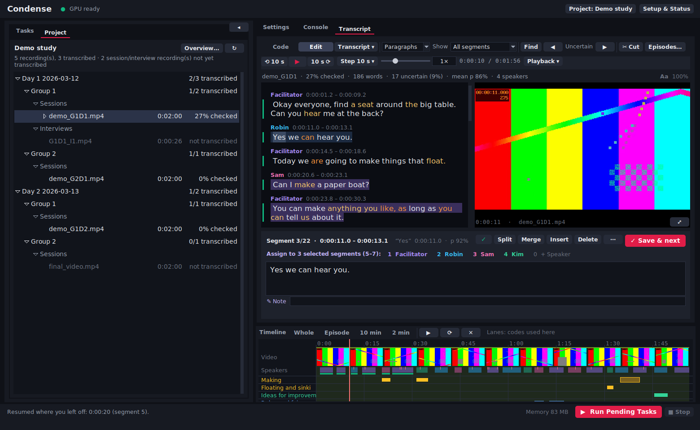
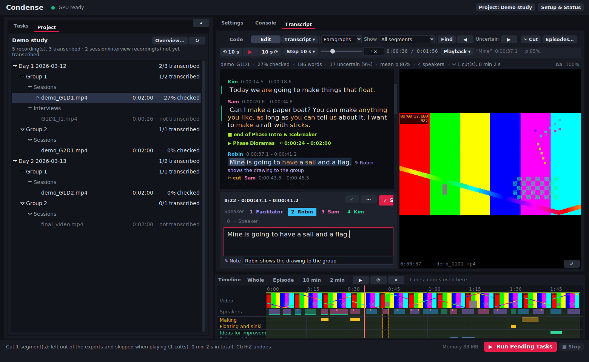
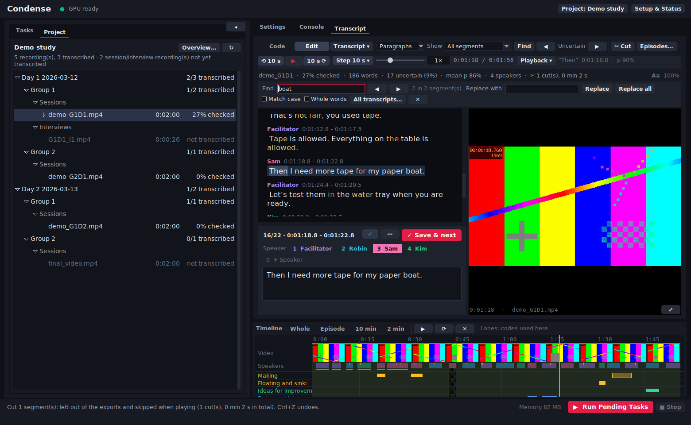
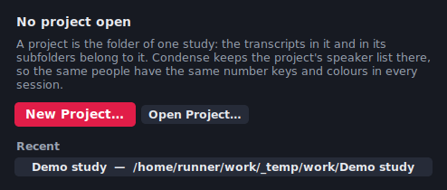
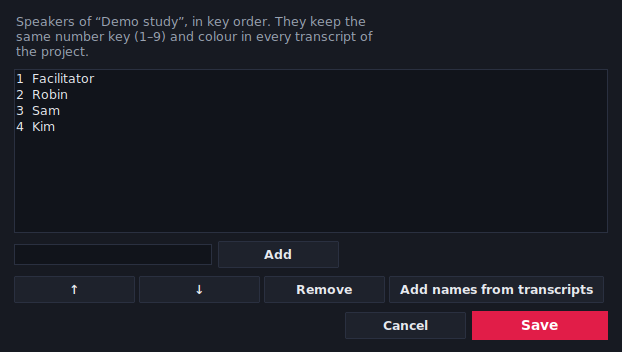

# Condense user guide

From recordings to a checked transcript in MAXQDA. Every picture shows invented demo data: a test pattern instead of
a video, made-up dialogue and the stand-in names Robin, Sam and Kim.

Shortcuts are written **Mac / Linux and Windows**, for example **⌘↩ / Ctrl+Enter**. *View ▸ Keyboard Shortcuts*
(⌘/ or Ctrl+/) lists them all for your system.

**Contents:**
1. [Install and update](#1-install-and-update)
2. [From recording to transcript](#2-from-recording-to-transcript)
3. [Trim before transcribing](#3-trim-before-transcribing)
4. [Reviewing a transcript](#4-reviewing-a-transcript)
5. [Speakers](#5-speakers)
6. [Notes, find and replace, filters](#6-notes-find-and-replace-filters)
7. [Cutting parts out](#7-cutting-parts-out)
8. [Projects: many sessions of one study](#8-projects-many-sessions-of-one-study)
9. [Into MAXQDA](#9-into-maxqda)
10. [Your data](#10-your-data)
11. [When something goes wrong](#11-when-something-goes-wrong)

---

## 1. Install and update

The install guides cover one-line installation for [macOS](install-mac.md), [Linux](install-linux.md) and
[Windows](install-windows.md).

- **Updates:** Condense checks once a day and offers new versions. To check by hand, use *Help ▸ Check for Updates…*
  (on the Mac, *Condense ▸ Check for Updates…*). It updates itself and restarts. You can turn the daily check off in
  the same menu.
- **Is the GPU working?** *Help ▸ Test GPU…* runs a short calculation on the graphics card and tells you whether
  Whisper will use it. Run it once after installing. Without a GPU, a one-hour recording can take hours instead of minutes.
  Condense also warns you before a run if the GPU is not usable.

## 2. From recording to transcript

1. **Add videos** (⌘O / Ctrl+O, or *+ Videos*): each video becomes one task. A session that was recorded as several
   clips (a camera that splits files) becomes one task with *+ Merge Task*: the clips are joined and you get a single
   transcript.
2. **Check the settings** (right). New tasks copy them, and each task keeps its own copy. *Task Details* (below the
   queue) shows a task's settings; *Use current Settings* updates a pending task. The settings that matter most:
   - **Steps:** *Compress* makes a smaller video for archiving and for MAXQDA. *Extract audio* keeps a separate audio
     file. *Transcribe* runs Whisper.
   - **Model:** `large-v3-turbo` is a good default. `large-v3` is slower and sometimes better with quiet or unclear
     speech.
   - **Language:** set it for single-language sessions. *Auto* only listens to the first 30 seconds.
   - **Vocabulary:** names, places and activity words Whisper should expect (`Robin, Sam, Riverside Club, papier-mâché`).
   - **Clean up for Whisper:** *Level quiet voices* helps with soft-spoken children. *Reduce noise + level voices* also
     helps in noisy rooms. Only what Whisper hears is cleaned; your video and audio stay as they are.
   - **Diarization / Speakers:** detects who speaks when. You get `SPEAKER_00`, `SPEAKER_01`, … and give them names
     afterwards (see [Speakers](#5-speakers)). If you know the number of speakers, enter it.
   - **Exports:** keep *Paragraphs RTF* on for MAXQDA.
3. **Run** (⌘R / Ctrl+R, or *Run Pending Tasks*). The *Console* tab shows each step. You can keep working on other
   transcripts while it runs.

Results go into a subfolder next to the video (`Interviews/P01.mp4` → `Interviews/P01/`), or into the output folder
you chose:

| File | What it is |
|---|---|
| `P01.transcript.json` | The master file: every word with its timing and confidence, speakers, notes, cuts, the settings, tool versions, checksums and a log of every edit. Everything else is generated from it. |
| `P01_paragraphs.rtf` / `.txt` | One paragraph per speaker turn, with a timestamp at the end of each. **For MAXQDA** and Word. |
| `P01.srt` / `.vtt` | Subtitles. |
| `P01.txt` | Plain text by segment. |
| `P01_confidence.rtf` | The transcript with words coloured by how sure Whisper was. Useful for spotting problems. |

The exports are rewritten every time you save a change in the editor.

## 3. Trim before transcribing

Setup time, breaks and the minutes after the session usually don't belong in the transcript. Select the task, then
use *Task Details ▸ Trim…*:

Click the frame strip to move through the video (← / → step 1 s, ⇧ 10 s; Space plays 5 s). Mark a part to leave out
with *Cut starts here* (**I**) and *Cut ends here* (**O**). *Save* writes a LosslessCut project (`.llc`) next to the
video. You can also make one in
[LosslessCut](https://github.com/mifi/lossless-cut) itself. With *Apply LosslessCut (.llc) trims* on in Settings, the
marked parts are skipped before transcribing, and the shortened video is kept next to the transcript so that its
timestamps match.

You can also cut parts out after transcribing (see [Cutting parts out](#7-cutting-parts-out)).

## 4. Reviewing a transcript

Open a finished task (click it in the queue) or *File ▸ Open Transcript…* (⇧⌘O / Ctrl+Shift+O). The *Transcript*
tab opens:

- **Top:** a timeline of the session (one colour per speaker; the ticks above it mark uncertain words), the player and the video.
- **Middle:** the transcript. Click a word to jump there; double-click to play from it. Words Whisper was unsure
  about are coloured: yellow, then orange, then red and underlined for the least certain.
- **Bottom:** the segment editor. It shows exactly the highlighted segment. Correct the text while listening.
  Unchanged words keep their exact timing. Every change is saved, logged and can be undone (⌘Z / Ctrl+Z).

**A fast review loop:** click into the transcript, then

| Key | |
|---|---|
| **Space** / **Esc** | play / pause (Esc also works while typing) |
| **R** | replay the segment |
| **↑ / ↓** | previous / next segment |
| **← / →** | previous / next uncertain word |
| **Return** | edit the segment's text |
| **⌘↩ / Ctrl+Enter** | save, mark checked, go to the next segment (also while typing) |
| **C** | mark checked / not checked |
| **1 – 9** | assign speaker 1–9 |
| ⌘[ ⌘] / Ctrl+[ Ctrl+] | back / forward 5 seconds |
| ⌘⇧. ⌘⇧, / Ctrl+Shift+. Ctrl+Shift+, | faster / slower |

The line above the transcript shows how much is **checked**. Checked segments get a ✓, and the queue shows the
percentage for each task. Condense remembers where you stopped in each transcript.

**Markers** for things Whisper can't write: *Markers ▾* in the editor, or while typing ⌃L ⌃I ⌃U ⌃C ⌃P ⌃G ⌃N on the Mac
and Ctrl+Shift+L, I, U, C, P, G, N on Linux and Windows. They insert `[laughs]`, `[inaudible 0:12:31]`, `[unclear: ]`,
`[crosstalk]`, `[pause]`, `[German]` and `[gestures]`.

**When Whisper got a passage badly wrong** (mumbling, a switch of language): select it and use *Edit ▸ Re-transcribe
Passage…* (⌘⇧R / Ctrl+Shift+R) with a bigger model or a forced language. *+ Segment*, *Split before word*, *Merge with
next* and *Delete* fix the segmentation.

## 5. Speakers

The chips under the editor are the speakers. Their numbers are the keys:

- **One segment:** click it and press its speaker's number. While typing in the editor, use ⌃1–9 on the Mac and
  Alt+1–9 on Linux and Windows.
- **A whole stretch:** drag across the transcript, ⇧-click / Shift+click, or ⇧↓ / Shift+↓. Then press the number.
  It is one change, and one undo.

  

- **0** adds a new speaker and assigns it.
- **Speakers…** (transcript toolbar) renames speakers everywhere in the transcript and its exports, for example
  `SPEAKER_01` → `Robin`. It also adds and removes speakers. Swapping two names works.

  

- **Detect speakers…** runs speaker detection again (for example with a different number of speakers). It keeps the
  speakers you assigned by hand.

Use pseudonyms here, not children's real names: the names end up in every export.

## 6. Notes, find and replace, filters

- **✎ Note** (under the segment text): a remark on a segment, such as context or something seen on video. Notes
  appear in the transcript and as `[Note: …]` in the TXT and paragraph exports.
- **Find & replace** (⌘F / Ctrl+F, or *Find…*): highlights every match. Return / ⇧Return step through them.
  *Replace* and *Replace all* are each one undo step, with options for case and whole words. Word timings stay.

  

- **Search all transcripts** (*Edit ▸ Search All Transcripts…*, or *All transcripts…* in the find bar): searches every
  transcript in a folder and its subfolders, and can replace everywhere. For example, it can correct a name Whisper
  always gets wrong, or swap a real name for a pseudonym. Each changed transcript gets a backup and new exports.
- **Show** filter (transcript toolbar): *Uncertain*, *Not checked*, *With notes* or *Cut*. ↑/↓ then move only through
  those segments.

## 7. Cutting parts out

Not everything recorded belongs in the analysis: setting up, a toilet break, a conversation with a parent. To cut a
segment, select it (or a stretch) and press **X**. It is struck through and left out of every export. X again restores
it, and *Edit ▸ Restore All Cuts…* restores everything. Nothing is deleted: cut segments stay in the master file. With
*Skip cuts* on, the player jumps over them.

The exports keep the **original timeline**: their timestamps match the original video. To get a **shortened video**
with a transcript timed to it, use *Export trimmed…* (or *File ▸ Export Trimmed Video & Transcript…*):

- **Exact:** cuts exactly where you cut. Re-encodes the video, which takes a while for long sessions.
- **Lossless:** fast and without quality loss, but each kept part starts at the nearest keyframe before it. Condense
  measures what was really written and times the transcript to that. Cuts too short to apply losslessly are listed.
- **LosslessCut project:** writes a `.llc` so you can fine-tune and export in LosslessCut yourself.

Use the trimmed video and the trimmed transcript **together** in MAXQDA (see below).

## 8. Projects: many sessions of one study

A **project** is the folder of one study. Every transcript in that folder or its subfolders belongs to it, for example
`Study/Session 1/…` and `Study/Session 2/…`. Nothing is moved or copied; Condense only puts a small
`condense-project.json` in the folder.

- **Start one:** *Project ▸ New Project…*, or the **No project open** button at the top right. Choose the study's
  folder: an existing one with sessions in it, or a new one you create in the folder chooser. Give the project a name
  and, if you like, its speakers.

  

- **Open one:** *Project ▸ Open Project…* (choose the study's folder) or *Project ▸ Open Recent*. Opening any transcript
  of a study also opens its project.
- **While a project is open,** its name is shown at the top right. *Open Transcript* and *Search All Transcripts* start
  in its folder. *Project ▸ Close Project* closes it; the transcripts stay where they are.
- **Getting sessions into it:** set a task's output folder (*Task Details ▸ Output*) to a folder inside the project, or
  keep your videos in the study folder (results are saved next to them). You can also move finished session folders
  into it.

**Project overview** (click the project's name, or *Project ▸ Project Overview…*) lists every transcript with its
length, how much is checked, the share of uncertain words, speakers (and how many still have no name), cut time,
notes and the last change. Double-click opens one. *Save as CSV* writes `condense-overview.csv`, for your records or
your supervisor.

**Project speakers** (*Project speakers…* in the overview, or *Project ▸ Project Speakers…*): the people of the study,
in a fixed order. They come first in every transcript of the project, so **Facilitator is always 1, Robin always 2**,
with the same colours, in every session. *Add names from transcripts* collects the names you have already used.

## 9. Into MAXQDA

MAXQDA links a transcript to its video through the timestamps at the end of each paragraph. That is the format of
Condense's paragraph exports.

1. In MAXQDA: *Import ▸ Transcripts* (in older versions *Transcripts with Timestamps*).
2. Choose `<name>_paragraphs.rtf` (or `.txt`).
3. When MAXQDA asks for the media file, choose **the video that matches the transcript**:
   - the original video, for the normal exports;
   - the **trimmed** video, for a trimmed transcript (from *Export trimmed…*, or from a run with `.llc` trims).

   MAXQDA only links the media file chosen during import; you can't add it later. If you pick the wrong video, the
   timestamps will point to the wrong moments.
4. Speakers appear as `Name:` at the start of each paragraph, so MAXQDA's focus-group import can code each speaker
   automatically.

MAXQDA can also import the `.srt` subtitles together with the video.

## 10. Your data

- **Everything stays on your computer.** Whisper and speaker detection run locally; nothing is uploaded. The only
  network access is the update check (to GitHub, sending no data) and, if you use it, downloading the pyannote speaker
  model with your Hugging Face token.
- The Hugging Face token is kept in the system keyring (Keychain, Secret Service or Credential Manager), never in a
  file.
- **Backups:** each transcript keeps automatic backups in a `_backups` folder next to it. To go back, use *Edit ▸
  Restore Backup…*.
- Follow your ethics approval and data-management plan for where recordings and transcripts are stored. Use
  pseudonyms in speaker names, notes and replacements.

## 11. When something goes wrong

- **Transcribing is very slow:** run *Help ▸ Test GPU…*. The [install guide](install-linux.md) for your system explains
  how to get the GPU working.
- **A task failed:** the *Console* tab shows the reason. Right-click the task and choose *Reset to Pending*, then run
  it again.
- **Whisper invents text in silence** (repeated phrases, "Thank you for watching"): trim the silent parts before
  transcribing, or cut those segments.
- **Speakers are mixed up:** enter the right number of speakers and use *Detect speakers…*, or fix stretches with
  multi-select and the number keys.
- **Report a problem:** [GitHub issues](https://github.com/Courage-pupper/condense/issues). Never attach recordings or
  transcripts of participants. Describe the problem, or reproduce it with a test video.
